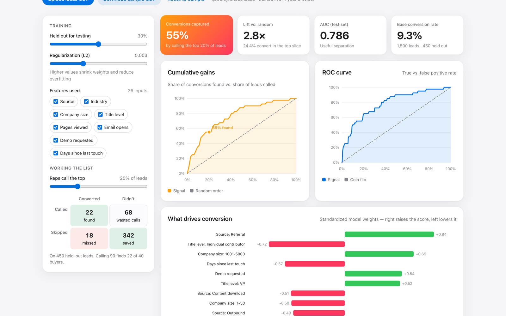

# Signal

Explainable lead scoring: train a logistic-regression model in the browser, evaluate it properly, and hand reps a ranked call list with reasons.

**[Live demo →](https://darshanpatil.me/work/signal/)**



## The problem

Sales teams have more leads than time. Calling in order of arrival wastes most calls, and black-box scores that reps don't trust get ignored. A good lead score needs to be **accurate**, **honestly evaluated**, and **explainable**.

## What it does

- Trains a **logistic regression** in the browser on 1,500 sample leads, or on any CSV with a 0/1 `converted` column.
- Evaluates it only on a **held-out test set**: AUC, ROC curve, and a cumulative gains chart.
- Translates the model into business terms: *"call the top 20% of leads and you find 55% of the buyers, 2.8× better than random."*
- Shows a confusion matrix for the chosen call-list size: found, missed, wasted calls, saved calls.
- Charts standardized **feature weights** (what drives conversion), with odds ratios on hover.
- Gives every lead the **top reasons** behind its score.
- Lets you toggle features on and off and adjust regularization to see the effect.

## How it works

- **Features:** text columns are one-hot encoded and numeric columns are standardized using training-set statistics only, so nothing leaks from the test set. ID-like columns (`lead_id`, `email`, …) are skipped automatically.
- **Training:** batch gradient descent on log-loss with L2 regularization, 400 epochs, on a seeded random train/test split.
- **AUC:** computed with the Mann–Whitney rank formulation, with ties handled.
- **Explanations:** for a linear model, each feature's contribution to the log-odds is exactly weight × value, so the reasons shown are the actual drivers of that score.

The sample leads are generated from a known logistic process plus noise, so the model's job is to recover that signal.

## Run it locally

No build step and no dependencies. Serve the folder with any static server:

```bash
python3 -m http.server 8000
# open http://localhost:8000
```

## Project structure

```
index.html   page layout and copy
app.js       data generation, model, and rendering
app.css      page-specific styles
kit.js       shared helpers: seeded RNG, CSV import/export, SVG charts, tooltips
kit.css      shared UI kit (light + dark mode)
```

Charts are hand-built SVG with no charting library. Everything runs client-side, so uploaded files never leave the browser.

## Data

The bundled sample data is **synthetic**, generated from a seeded random process so it is reproducible. It does not describe any real company or customer.

---

Built by [Darshan Patil](https://darshanpatil.me) · [LinkedIn](https://www.linkedin.com/in/darshan-patil-/)
